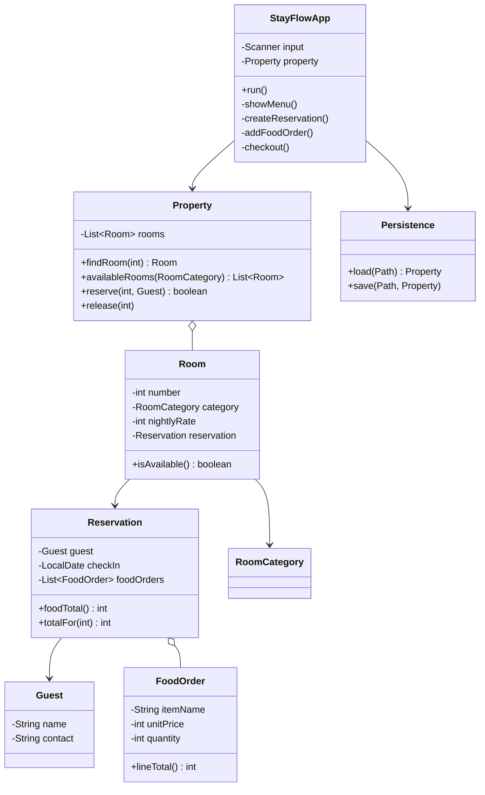

# Design notes

## Responsibilities

- **StayFlowApp** — owns the console interaction loop and validates user input.
- **Property** — creates the fixed room inventory and coordinates room lookup and reservation changes.
- **Room** — stores a room number, category, nightly rate, and optional active reservation.
- **Guest** — stores the name and contact value supplied for a reservation.
- **Reservation** — stores guest information, check-in date, and ordered food items.
- **FoodOrder** — calculates a line total from menu item and quantity.
- **Persistence** — serializes the current `Property` snapshot to a local file and restores it on startup.

## Class relationship diagram

## Important scope limits

This is a learning project. Java object serialization is used for simplicity, not as a recommended production storage format. Production systems should use a database, authentication and authorization, data validation appropriate to local law, backups, and secure handling of personal information.
